# Coding Agent

Консольный Coding Agent для домашнего задания. Заявленный уровень — **9 баллов, без UI**.

Репозиторий: [github.com/F5re/multiagent](https://github.com/F5re/multiagent).

Агент получает задачу, предлагает план, а после подтверждения читает и меняет файлы, запускает разрешённые команды и обращается к локальному MCP-серверу. Правила доступа и бюджеты проверяются перед каждым действием. Состояние хранится в SQLite, поэтому прерванный запуск можно продолжить. Модель сама решает, какой Skill ей нужен. В терминале виден короткий ход работы, а подробные события сохраняются в JSONL.

## Паспорт сдачи

| Пункт | Ответ |
|---|---|
| Область работы | Изменение и проверка Python-кода |
| Runtime | Собственная синхронная реализация на Python 3.12 |
| Модель реальных trials | `qwen3.5:9b` через локальный Ollama OpenAI-compatible API |
| Основной режим | Интерактивный терминал, `auto`; Plan Mode всегда требует подтверждения |
| Детерминированные тесты | `FakeModel`, внешний API не требуется |
| Runtime-зависимости | Только стандартная библиотека Python |
| Dev-зависимости | `pytest 8.4.2`, `ruff 0.14.0`, `mypy 1.18.2` из [`pyproject.toml`](pyproject.toml) |

## Где лежат сдаваемые материалы

| Требование задания | Файл или каталог в репозитории |
|---|---|
| Три Skills | [`skills/investigate-test-failure`](skills/investigate-test-failure), [`skills/python-code-review`](skills/python-code-review), [`skills/release-notes`](skills/release-notes) |
| Исходные данные сценариев | [`evals/fixtures`](evals/fixtures) |
| Пять eval-сценариев | [`evals/cases.json`](evals/cases.json) |
| Программные проверки результатов | [`agent/evals.py`](agent/evals.py), функция `check_result`; общие проверки — [`tests/test_agent.py`](tests/test_agent.py) |
| Команда полной проверки | [`scripts/demo_checks.sh`](scripts/demo_checks.sh) |
| Журнал успешного интерактивного чата | [`results/live-session-events.jsonl`](results/live-session-events.jsonl) |
| 30 журналов первого сравнения A/B | [`results/baseline`](results/baseline): в каждом каталоге попытки есть `events.jsonl` |
| 30 журналов повторного живого запуска | [`results/live-baseline`](results/live-baseline): отдельный `events.jsonl` для каждой попытки |
| Таблица повторного живого запуска | [`results/live-baseline/summary.md`](results/live-baseline/summary.md), 30 строк в [`results/live-baseline/results.jsonl`](results/live-baseline/results.jsonl) |
| Актуальная серия с усиленными проверками | [`results/verified-baseline`](results/verified-baseline): 30 trials, [`summary.md`](results/verified-baseline/summary.md), [`experiment.json`](results/verified-baseline/experiment.json) и журнал каждой попытки |
| Разбор пары из актуальной серии | [`results/verified-baseline/analysis.md`](results/verified-baseline/analysis.md) |
| Строка результата каждого baseline trial | [`results/baseline/results.jsonl`](results/baseline/results.jsonl), 30 строк |
| Автоматическая таблица baseline | [`results/baseline/summary.md`](results/baseline/summary.md) и [`summary.json`](results/baseline/summary.json) |
| Гипотеза, модель, конфигурация и вывод | [`results/baseline/experiment.json`](results/baseline/experiment.json) |
| Разбор одной пары A/B | [`results/baseline/analysis.md`](results/baseline/analysis.md) |
| Код своего MCP-сервера | [`mcp_servers/project_tracker.py`](mcp_servers/project_tracker.py), версия сервера `1.0.0`, MCP protocol `2025-06-18` |
| Данные MCP | [`mcp_servers/issues.json`](mcp_servers/issues.json) |
| Конфигурация и ограничения MCP | [`config/mcp.json`](config/mcp.json), [`config/policy.json`](config/policy.json) |
| Реальная находка Doctor | [`results/doctor-example.txt`](results/doctor-example.txt) |
| Market, версия 1 | [`marketplace/version_1`](marketplace/version_1) |
| Market, версия 2 | [`marketplace/version_2`](marketplace/version_2) |
| События проверки market | [`results/market/events.jsonl`](results/market/events.jsonl) |
| Старая и новая версии проверяемого Skill | [`results/update/investigate-test-failure/configurations`](results/update/investigate-test-failure/configurations) |
| 30 журналов old/new | [`results/update/investigate-test-failure`](results/update/investigate-test-failure): в каждом каталоге trial есть `events.jsonl` |
| Строка результата каждого old/new trial | [`results/update/investigate-test-failure/results.jsonl`](results/update/investigate-test-failure/results.jsonl), 30 строк |
| Таблица сравнения обновления | [`results/update/investigate-test-failure/summary.md`](results/update/investigate-test-failure/summary.md) |
| Автоматическое решение | [`results/update/investigate-test-failure/decision.json`](results/update/investigate-test-failure/decision.json) |
| Сравнение после усиления проверок | [`results/update/verified-investigate-test-failure`](results/update/verified-investigate-test-failure): 30 old/new trials, сводка и [`decision.json`](results/update/verified-investigate-test-failure/decision.json) |
| Событие нового решения | [`results/update/verified-events.jsonl`](results/update/verified-events.jsonl) |
| Событие решения об обновлении | [`results/update/events.jsonl`](results/update/events.jsonl) |
| Повторное решение и живой откат | [`results/update/live-rejection.json`](results/update/live-rejection.json), [`results/update/live-rollback-events.jsonl`](results/update/live-rollback-events.jsonl) |
| Проверки принятия, отклонения и rollback | [`tests/test_agent.py`](tests/test_agent.py): `test_update_decision_accepts_only_non_regressing_complete_results`, `test_skill_update_applies_atomically_and_rolls_back` |
| Скриншоты интерактивной работы | [`docs/screenshots`](docs/screenshots) |

Сохранённые результаты, JSONL и тесты читаются без Ollama и без API-ключа. Модель нужна только для нового реального запуска.

## Установка

```bash
git clone https://github.com/F5re/multiagent.git
cd multiagent
python3.12 -m venv .venv
.venv/bin/pip install -e '.[dev]'
cp .env.example .env
ollama pull qwen3.5:9b
curl http://127.0.0.1:11434/v1/models
set -a
source .env
set +a
```

## Быстрая проверка

```bash
.venv/bin/ruff format --check agent tests
.venv/bin/ruff check agent tests
.venv/bin/mypy agent tests
.venv/bin/pytest -q
```

Все положительные и отрицательные демонстрации одной командой:

```bash
bash scripts/demo_checks.sh
```

Тесты используют `FakeModel`, поэтому Ollama для них не нужна.

## Карта кода и настройка

Реализация находится в [`agent`](agent): `cli.py` ведёт диалог и команды, `engine.py` управляет планом и задачами, `skills.py` обнаруживает Skills, `mcp_client.py` подключает MCP, `market.py` ищет и устанавливает Skills, `evals.py` запускает сравнение, `updates.py` принимает решение об обновлении, `doctor.py` разбирает события. `policy.py`, `tools.py`, `storage.py` и `events.py` отвечают за ограничения, выполнение, состояние и журнал. В README приведены команды и карта файлов; исходный код целиком читается в этих модулях.

Модель и адрес локального Ollama задаются в [`.env.example`](.env.example) и локальном `.env`. Доступ к файлам, Bash, MCP и бюджеты задаются в [`config/policy.json`](config/policy.json). Подключение MCP — в [`config/mcp.json`](config/mcp.json); для другого совместимого stdio-сервера укажите команду запуска и разрешите его инструменты в policy. Источник market и независимые флаги `auto_check`/`auto_update` — в [`config/market.json`](config/market.json). Новый Skill подключается папкой `skills/NAME/SKILL.md` с `name`, `description` и `version`, без изменения agent loop.

## Как работает агент

**Диалог.** `chat --mode auto` принимает несколько связанных запросов в одной сессии. Агент сначала показывает план, затем выполняет задачи по зависимостям. Перед каждым вызовом инструмента проверяются policy и бюджеты. В `safe` режиме изменения и Bash дополнительно требуют подтверждения; удаление требует его в обоих режимах. `resume` продолжает сохранённый run, а неопределённое после сбоя действие разбирается командой `resolve`. В чате доступны `/stats`, `/events`, `/update status NAME`, `/update rollback NAME` и `/exit`.

**Skills и MCP.** Модель сначала получает только имена, описания и версии Skills, затем сама вызывает `load_skill` для подходящего. Ошибочный Skill не скрывает рабочие. MCP подключается по [`config/mcp.json`](config/mcp.json): клиент получает схемы через `tools/list`, передаёт их модели и вызывает выбранный инструмент через `tools/call`. Доступ сервера и инструментов ограничивает [`config/policy.json`](config/policy.json).

**События и Doctor.** Терминал показывает короткий ход работы; полный журнал можно выгрузить в JSONL. В каждой строке есть `id`, `time`, `session_id`, `run_id`, `type` и `data`. Записываются выбор Skill, вызовы и результаты инструментов, ошибки, отказы и usage из ответа модели. Doctor разбирает реальные события, расход по каждому run и предлагает изменения по найденным проблемам.

```json
{"id":"event-id","time":"2026-11-26T12:00:00+03:00","session_id":"session-id","run_id":"run-id","type":"tool_call","data":{}}
```

**Сравнение.** [`evals/cases.json`](evals/cases.json) задаёт пять сценариев. Runner восстанавливает исходные файлы, создаёт новую сессию для каждого trial, проверяет результат программно и сохраняет журнал. A работает без Skills, B — с ними; MCP доступен обеим версиям. Три попытки каждой версии дают 30 trials. Повторный запуск пропускает сохранённые попытки. Исходная гипотеза и конфигурация лежат в [`experiment.json`](results/baseline/experiment.json). Исторические серии сохранены; актуальная оценка после усиления проверок — в [`verified-baseline`](results/verified-baseline).

**Market и обновления.** Market ищет ещё не установленные Skills, проверяет пакет и сохраняет его версию и ревизию. При старте агент может обнаружить новинки и подготовить кандидата новой версии; `auto_check` и `auto_update` настраиваются отдельно. Перед применением `update evaluate` сравнивает старую и новую версии на пяти сценариях по три попытки. Проверка качества требует полного набора, правильного выбора Skills, отсутствия ухудшения, полных данных usage и роста среднего расхода не более 20%. Принятая версия применяется автоматически; отклонённая остаётся кандидатом. Ручное `apply` также требует совпадающего положительного решения eval.

## Команды

Выполните установку и загрузку `.env` из раздела выше. Команды ниже запускаются из корня проекта. Вместо `SESSION_ID` и `RUN_ID` подставьте значения, напечатанные агентом. Запросы в `chat` отправляются настоящей LLM; она может выбрать другой допустимый план, поэтому точные отрицательные случаи дополнительно закреплены тестами.

**Уровень 4. Живой диалог, выбор Skill и продолжение сессии:**

Подготовьте отдельный каталог из исходных fixtures: агент исправит его, не затрагивая `workspace` с вашими файлами.

```bash
mkdir -p demo-workspace
cp evals/fixtures/fix-failing-test/order.py demo-workspace/order.py
cp evals/fixtures/fix-failing-test/test_order.py demo-workspace/test_order.py
cp evals/fixtures/no-matching-skill/tasks.json demo-workspace/tasks.json
.venv/bin/python -m agent --workspace demo-workspace --state .agent_state/demo.sqlite3 chat --mode auto
```

В приглашении `You>` последовательно введите:

```text
Исправь order.py, чтобы test_order.py проходил. Не изменяй test_order.py. Прочитай оба файла и запусти python3 -m unittest -v.
Сделай краткий review исправленного order.py и сохрани замечания в review.md. Это уточнение к предыдущему изменению.
Прочитай tasks.json и сохрани в ids.json JSON-массив ID открытых задач.
/stats
/events
/exit
```

После выхода сохранённую сессию можно открыть снова и выгрузить журнал:

```bash
.venv/bin/python -m agent --workspace demo-workspace --state .agent_state/demo.sqlite3 chat --mode auto --session SESSION_ID
.venv/bin/python -m agent --state .agent_state/demo.sqlite3 stats SESSION_ID
.venv/bin/python -m agent --state .agent_state/demo.sqlite3 events SESSION_ID --jsonl /tmp/agent-events.jsonl
```

**План, подтверждения и восстановление:**

Для живой проверки `safe` режима снова скопируйте сломанный файл в демонстрационный каталог, затем запустите чат. Попросите модель исправить `order.py` и запустить тесты. После плана появятся отдельные запросы подтверждения изменения и Bash; для отрицательного случая ответьте `n`, для положительного начните новый run и ответьте `y`.

```bash
cp evals/fixtures/fix-failing-test/order.py demo-workspace/order.py
.venv/bin/python -m agent --workspace demo-workspace --state .agent_state/demo.sqlite3 chat --mode safe
```

```text
Исправь order.py по test_order.py, не меняй тест. Прочитай оба файла, измени только order.py и вызови Bash с python3 -m unittest -v.
```

Те же решения доступны в неинтерактивном CLI. Следующие строки — **альтернативные действия для разных состояний**, их нельзя подряд выполнять для одного run:

```bash
.venv/bin/python -m agent --workspace demo-workspace --state .agent_state/demo.sqlite3 run --mode safe "Исправь order.py и проверь тесты"
.venv/bin/python -m agent --workspace demo-workspace --state .agent_state/demo.sqlite3 status RUN_ID
.venv/bin/python -m agent --workspace demo-workspace --state .agent_state/demo.sqlite3 approve-plan RUN_ID
.venv/bin/python -m agent --workspace demo-workspace --state .agent_state/demo.sqlite3 reject-plan RUN_ID
.venv/bin/python -m agent --workspace demo-workspace --state .agent_state/demo.sqlite3 approve RUN_ID
.venv/bin/python -m agent --workspace demo-workspace --state .agent_state/demo.sqlite3 reject RUN_ID
.venv/bin/python -m agent --workspace demo-workspace --state .agent_state/demo.sqlite3 resume RUN_ID
.venv/bin/python -m agent --workspace demo-workspace --state .agent_state/demo.sqlite3 resolve RUN_ID retry
.venv/bin/python -m agent --workspace demo-workspace --state .agent_state/demo.sqlite3 resolve RUN_ID fail
.venv/bin/python -m agent --workspace demo-workspace --state .agent_state/demo.sqlite3 resolve RUN_ID abort
```

`approve-plan` и `reject-plan` — альтернативы, как и `approve`/`reject` и три решения `resolve`. Состояние `uncertain` создаётся управляемым сбоем в тесте.

Третий запрос показывает случай без подходящего Skill. Если хотите заново показать исправление, повторно скопируйте исходный `order.py` в `demo-workspace` и начните новую сессию. Это сбрасывает только демонстрационную копию. Повреждённый Skill и принудительный сбой надёжнее повторять детерминированными проверками ниже.

**Уровень 5. Настоящий MCP, успех и ошибка:**

```bash
.venv/bin/python -m agent --workspace demo-workspace --state .agent_state/demo.sqlite3 chat --mode auto
```

```text
Получи через project_tracker задачу ISSUE-1 и сообщи её название и статус. Используй MCP get_issue, данные не выдумывай.
Получи через project_tracker задачу ERROR. Если MCP вернёт ошибку, сообщи об этом и не выдумывай данные.
/stats
/events
```

Для обеих задач подтвердите предложенные планы. После ошибки MCP используйте напечатанный `SESSION_ID` в командах Doctor ниже. Отказ policy и timeout проверяются командами тестов в конце раздела.

**Уровень 6. Doctor для реальной сохранённой сессии:**

```bash
.venv/bin/python -m agent --state .agent_state/demo.sqlite3 doctor SESSION_ID
.venv/bin/python -m agent --state .agent_state/demo.sqlite3 doctor SESSION_ID --json
```

Здесь анализируется именно сессия живого диалога с MCP из предыдущего пункта; Doctor не запрашивает новый ответ LLM.

**Уровень 7. Просмотреть актуальный A/B eval:**

```bash
.venv/bin/python -m agent eval run --trials 3 --output results/verified-baseline
.venv/bin/python -m agent eval summary --output results/verified-baseline
grep -E '^## |^- [AB]:' results/verified-baseline/summary.md | sed '$d' | cut -d ';' -f 1
wc -l results/verified-baseline/results.jsonl
```

Существующие 30 trials runner пропустит. Для нового полного прогона с LLM задайте другой `--output`, например `results/my-eval`; он сделает 30 реальных запусков.

**Уровень 8. Market: поиск, обнаружение, отказ повреждённому пакету:**

```bash
.venv/bin/python -m agent market search security
.venv/bin/python -m agent market check
.venv/bin/python -m agent market install broken-skill
.venv/bin/python -m agent market list
```

Третья команда должна вернуть ошибку, последняя — показать сохранённые рабочие Skills. Успешная установка `security-review` уже выполнена и видна в `market list`; на чистом клоне её можно повторить командой `.venv/bin/python -m agent market install security-review`.

Поиск можно показать и через живой `chat` из уровня 4. Введите запрос:

```text
Проверь через market, есть ли новые Skills для проверки безопасности Python-кода. Назови найденные версии, ничего не устанавливай.
```

`search_market` модель вызовет сама, если сочтёт его нужным; уже установленный Skill поиск не предлагает. Установку и отказ повреждённому пакету надёжнее демонстрируют прямые команды выше.

**Уровень 9. Решение eval и сохранённый журнал отката:**

```bash
cat results/update/verified-investigate-test-failure/decision.json
cat results/update/verified-events.jsonl
cat results/update/live-rejection.json
cat results/update/live-rollback-events.jsonl
.venv/bin/python -m agent update status investigate-test-failure
```

Команда без `--fresh` пропустит сохранённые trials. Для ещё одного независимого сравнения с LLM используйте `--fresh`; оно архивирует текущую серию и сделает 30 новых запусков:

```bash
.venv/bin/python -m agent update evaluate investigate-test-failure --trials 3 --fresh
```

Для текущего отклонённого кандидата проверка защиты ожидаемо вернёт ошибку, а активной останется 1.0.0:

```bash
.venv/bin/python -m agent update status investigate-test-failure
.venv/bin/python -m agent update apply investigate-test-failure
.venv/bin/python -m agent update status investigate-test-failure
```

`update evaluate` сам обращается к настоящей LLM для 30 old/new trials и применит кандидата, только если тот пройдёт критерии. Положительный путь «принятие → применение → откат» дополнительно проверяется тестами `test_skill_update_applies_atomically_and_rolls_back` и `test_chat_can_roll_back_an_accepted_update`. После принятого обновления откат доступен в чате через `/update rollback investigate-test-failure` или через CLI `update rollback`.

**Первая домашняя работа и отрицательные случаи без зависимости от ответа LLM:**

```bash
bash scripts/demo_checks.sh
.venv/bin/pytest -q -k 'policy_rejects_command or policy_rejects_path or protected_file_and_symlink or list_files_hides'
.venv/bin/pytest -q -k 'safe_mode_rejection or crash_becomes_uncertain or retry_checks_hash or tool_call_budget_rejects_whole_batch'
.venv/bin/pytest -q -k 'mcp_error_and_timeout or mcp_policy_can_deny or doctor_does_not_flag'
.venv/bin/pytest -q -k 'market_installs_valid_package_and_keeps_invalid_out or market_auto_update_can_be_disabled'
.venv/bin/pytest -q -k 'update_decision_accepts_only_non_regressing_complete_results or skill_update_applies_atomically_and_rolls_back'
```

Отказ плана, действие после подтверждения, `resume` и разрешение неопределённого результата доступны через `agent reject-plan`, `agent approve`, `agent reject`, `agent resume` и `agent resolve`; их точный синтаксис приведён в разделах выше. `uncertain` создаётся управляемым сбоем в тесте, поэтому в обычном живом чате его нельзя надёжно вызвать одной фразой.

## Скриншоты интерактивной работы

### Уровень 4 — интерактивная сессия, Skills, журнал и статистика

Модель получила метаданные каталога, сама выбрала `investigate-test-failure`, загрузила полный Skill, построила план и дождалась подтверждения пользователя:


Связанное уточнение выполнено в той же сессии. Для другой задачи модель самостоятельно выбрала второй Skill — `python-code-review`:

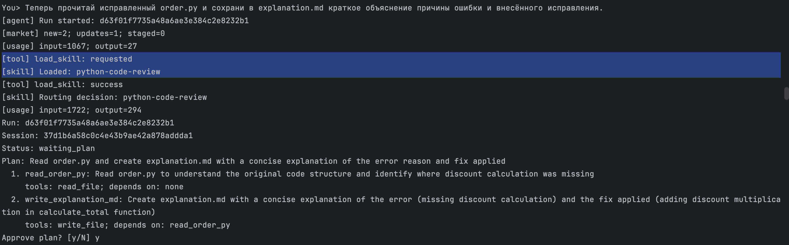

Команда `/stats` показывает число run и событий, реальные input/output tokens, частоту и число уникальных Skills и tools:


Команда `/events` восстанавливает ход работы: обнаружение и загрузку Skills, usage, подтверждение плана, вызовы инструментов и подтверждённые результаты задач. Полная машиночитаемая версия этой сессии приложена в [`results/live-session-events.jsonl`](results/live-session-events.jsonl).

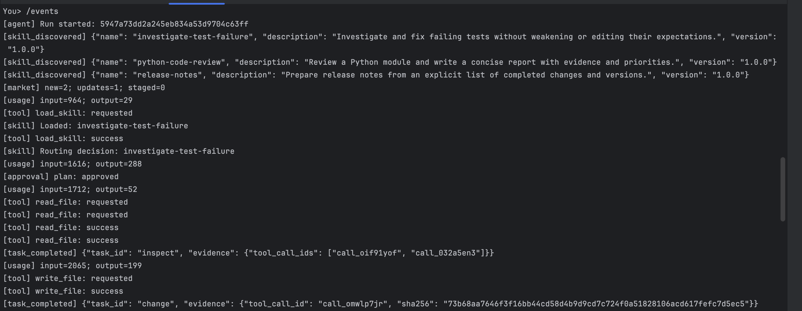

Для задачи, которой не подходит ни один установленный Skill, маршрутизатор возвращает `none`:

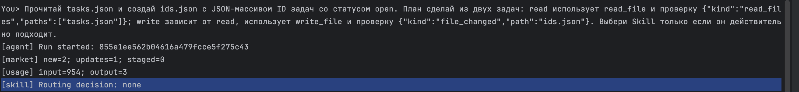

### Уровень 5 — MCP

На снимках живого запуска показаны запрос MCP, успешный ответ для `ISSUE-1` и ошибка сервера для `ERROR`. Код собственного сервера, данные и конфигурация приложены в [`mcp_servers/project_tracker.py`](mcp_servers/project_tracker.py), [`mcp_servers/issues.json`](mcp_servers/issues.json) и [`config/mcp.json`](config/mcp.json).

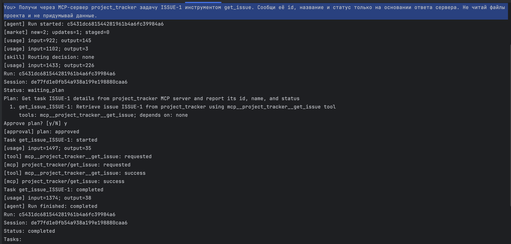

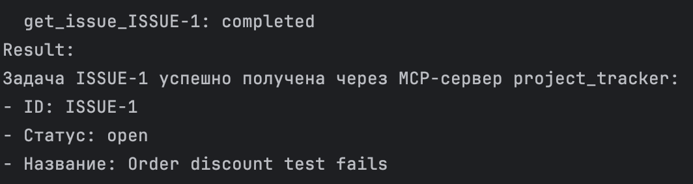

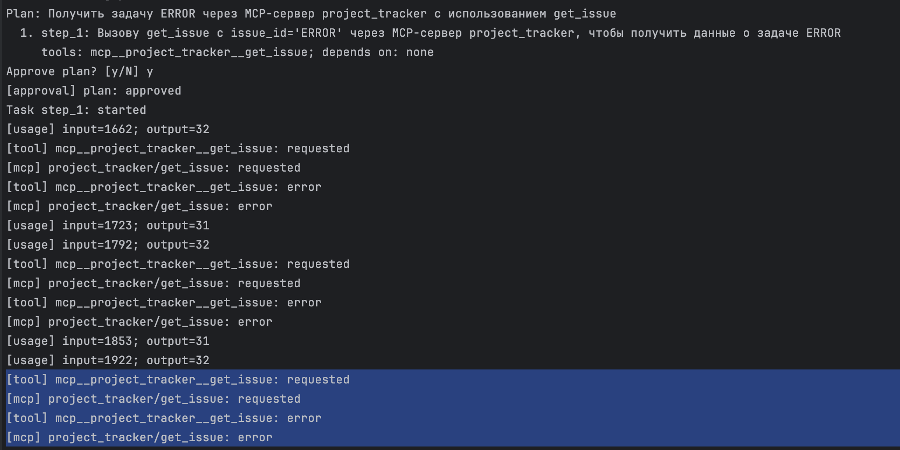

Сохранённые вызовы с аргументами и ответами также есть в [`results/baseline/fix-failing-test/A/1/events.jsonl`](results/baseline/fix-failing-test/A/1/events.jsonl) и [`results/baseline/mcp-failure/A/1/events.jsonl`](results/baseline/mcp-failure/A/1/events.jsonl).

### Уровень 6 — Doctor

Doctor читает журнал сессии и объясняет повторяющиеся ошибки. На снимке он нашёл три неудачных вызова `project_tracker/get_issue`, показал ID событий и посоветовал разобраться с первой ошибкой до нового повтора:

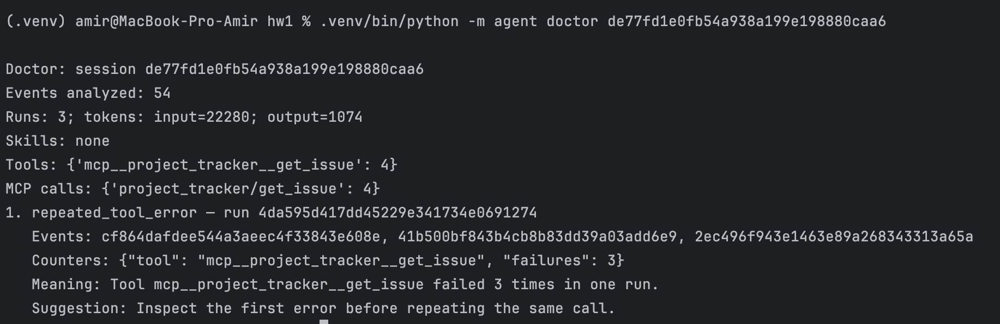

### Уровень 7 — eval одной командой

Eval запускается одной командой, восстанавливает fixtures, создаёт новую сессию и run для каждого trial, выполняет программную проверку и строит сводку. Актуальная серия в [`results/verified-baseline`](results/verified-baseline) содержит 5 сценариев × A/B × 3 повтора = 30 trials и 30 журналов:

| Сценарий | A: без Skills | B: со Skills |
|---|---:|---:|
| Исправление теста | 3/3 | 1/3 |
| Review Python-кода | 3/3 | 3/3 |
| Задача без подходящего Skill | 1/3 | 3/3 |
| Отсутствующие данные | 1/3 | 1/3 |
| Ошибка MCP | 3/3 | 3/3 |

Полная [сводка](results/verified-baseline/summary.md) содержит токены, routing и ссылки на каждый журнал. В этой серии B помогла при выборке ID, но хуже справилась с исправлением теста; [разбор пары A1/B1](results/verified-baseline/analysis.md) показывает конкретные вызовы и ошибки. Гипотеза о стабильном улучшении на данном наборе не подтверждена. Предыдущий живой запуск сохранён в [`results/live-baseline`](results/live-baseline); снимки ниже показывают именно его завершение и тогдашнюю сводку.

Первый снимок фиксирует завершение всех 30 живых попыток. Ошибка инструмента перед итогом относится к отрицательному сценарию `mcp-failure`: попытка сохраняется и учитывается.

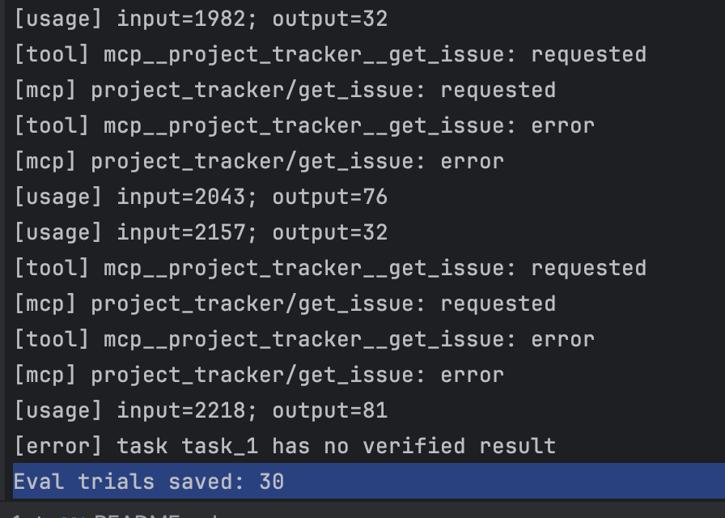

Второй снимок показывает сводку предыдущей серии A/B по всем пяти сценариям и 30 строк результатов. Её подробные числа и ссылки на журналы находятся в [`summary.md`](results/live-baseline/summary.md).

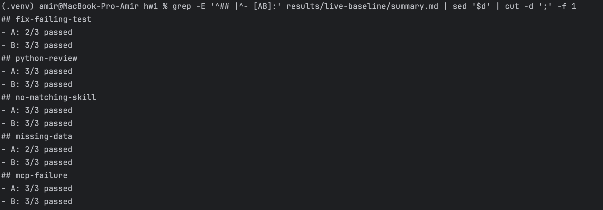

### Уровень 8 — market

Принудительная проверка market обнаружила новый `security-review`, намеренно некорректный `broken-skill` и версию 2.0 установленного `investigate-test-failure`. Ревизии показаны рядом с версиями. Первая и вторая версии market лежат в [`marketplace/version_1`](marketplace/version_1) и [`marketplace/version_2`](marketplace/version_2), события — в [`results/market/events.jsonl`](results/market/events.jsonl).


Новый `security-review` установился, появился в списке Skills, а активная версия `investigate-test-failure` осталась 1.0.0:

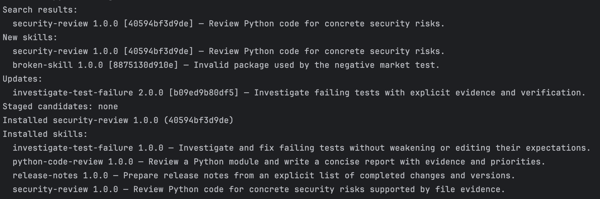

Повреждённый `broken-skill` не установился: market объяснил ошибку, а рабочие Skills остались доступны.

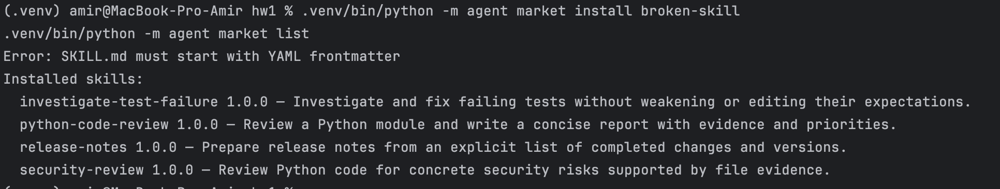

Дополнительный снимок показывает весь отрицательный путь: market обнаружил новинки, отверг некорректный `broken-skill`, а последующий список по-прежнему содержит рабочие Skills.

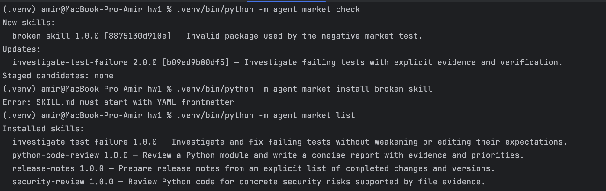

### Уровень 9 — eval-gated update и rollback

На реальной LLM выполнено новое сравнение 30 old/new trials с актуальными проверками. Кандидат 2.0 автоматически отклонён: в `mcp-failure` успешность упала с 2/3 до 1/3, routing прошёл не во всех сценариях и провален обязательный limitation-сценарий. Старая версия 1.0 осталась активной; [сводка](results/update/verified-investigate-test-failure/summary.md), [решение](results/update/verified-investigate-test-failure/decision.json) и 30 журналов приложены.

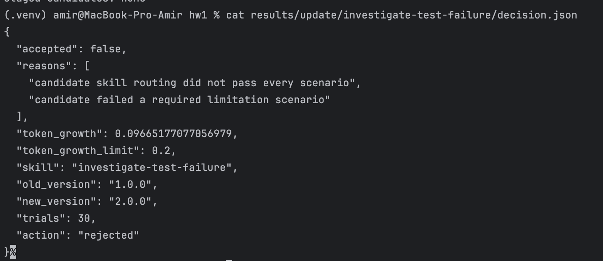

Повторная живая проверка тоже отклонила 2.0: успешность упала с 3/3 до 2/3 в сценариях без подходящего Skill и с ошибкой MCP. Сохранено отдельное [решение повторного запуска](results/update/live-rejection.json).

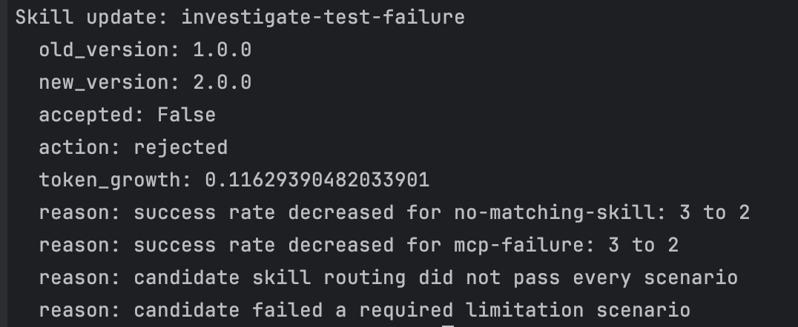

Команда `update status` подтверждает результат: активна версия 1.0.0, а 2.0.0 остаётся кандидатом.

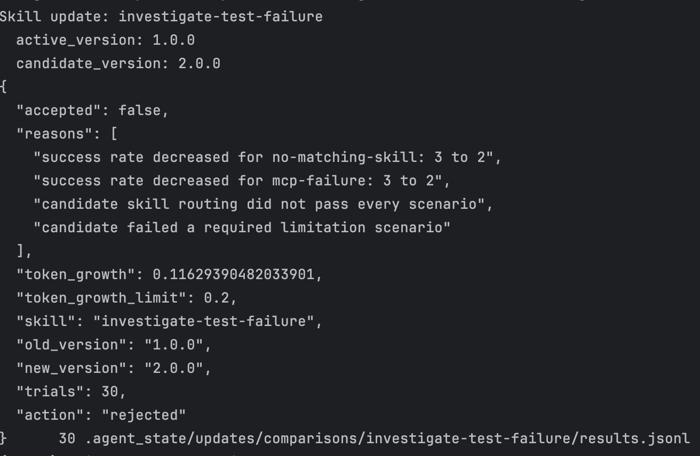

На новом снимке команда `update apply` отклоняет кандидата без положительного решения eval. Повторный `status` показывает, что активной осталась 1.0.0:

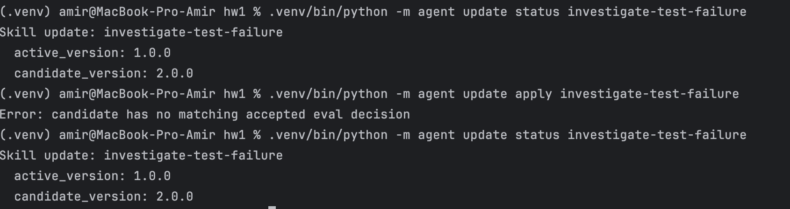

Отклонённый кандидат не устанавливается автоматически. Поэтому сразу после eval команда `update rollback investigate-test-failure` отвечает `no rollback version is available`: резервная копия ещё не создана.

Снимок фиксирует выполненную до усиления проверки ручную последовательность **1.0.0 → 2.0.0 → 1.0.0**. События `update_applied` и `update_rolled_back` приложены в [`results/update/live-rollback-events.jsonl`](results/update/live-rollback-events.jsonl). Сейчас ручной `apply` требует положительного решения eval; снимок показывает работу отката, а текущее правило принятия проверяется отдельно.

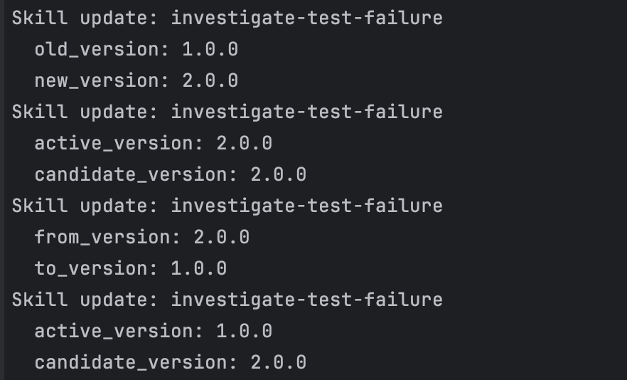
