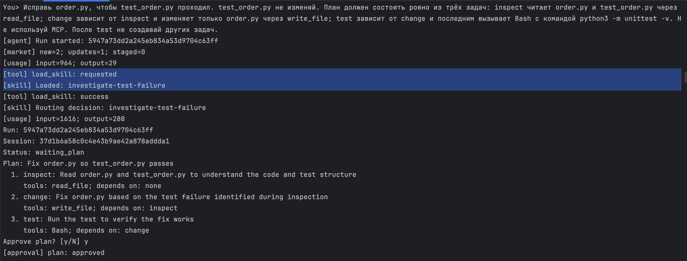
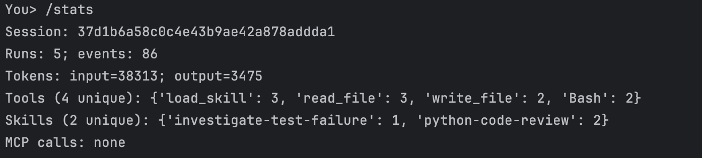
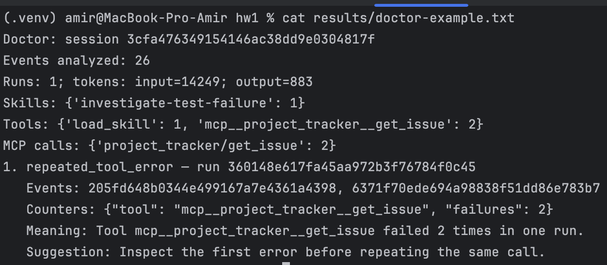
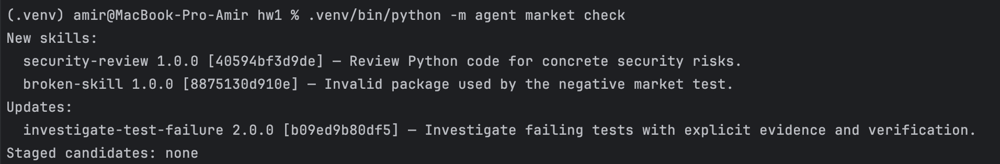

# Coding Agent

Консольный coding agent на Python 3.12. Заявленный уровень домашнего задания — **9 баллов, без UI**.

Репозиторий: https://github.com/F5re/multiagent

Агент строит план, вызывает файловые инструменты, Bash и MCP, применяет policy, сохраняет состояние в SQLite и продолжает запуск после сбоя. Skills выбираются моделью динамически. События хранятся в JSONL, а в терминале показываются коротко и понятно.

## Паспорт сдачи

| Пункт | Ответ |
|---|---|
| Заявленный уровень | **9** |
| Репозиторий | [github.com/F5re/multiagent](https://github.com/F5re/multiagent) |
| Область работы | Изменение и проверка Python-кода |
| Runtime | Собственная синхронная реализация на Python 3.12 |
| Модель реальных trials | `qwen3.5:9b` через локальный Ollama OpenAI-compatible API |
| Основной режим | Интерактивный терминал, `auto`; Plan Mode всегда требует подтверждения |
| Детерминированные тесты | `FakeModel`, внешний API не требуется |
| Runtime-зависимости | Только стандартная библиотека Python |
| Dev-зависимости | `pytest 8.4.2`, `ruff 0.14.0`, `mypy 1.18.2` из [`pyproject.toml`](pyproject.toml) |
| UI | Не реализован, потому что заявлен уровень 9, а UI относится к уровню 10 |

## Где лежат сдаваемые материалы

| Требование задания | Файл или каталог в репозитории |
|---|---|
| Три Skills | [`skills/investigate-test-failure`](skills/investigate-test-failure), [`skills/python-code-review`](skills/python-code-review), [`skills/release-notes`](skills/release-notes) |
| Исходные данные сценариев | [`evals/fixtures`](evals/fixtures) |
| Пять eval-сценариев | [`evals/cases.json`](evals/cases.json) |
| Программные проверки результатов | [`agent/evals.py`](agent/evals.py), функция `check_result`; общие проверки — [`tests/test_agent.py`](tests/test_agent.py) |
| Команда полной проверки | [`scripts/demo_checks.sh`](scripts/demo_checks.sh) |
| Журнал успешного интерактивного чата | [`results/live-session-events.jsonl`](results/live-session-events.jsonl) |
| 30 журналов baseline A/B | [`results/baseline`](results/baseline): в каждом каталоге trial есть `events.jsonl` |
| Строка результата каждого baseline trial | [`results/baseline/results.jsonl`](results/baseline/results.jsonl), 30 строк |
| Автоматическая таблица baseline | [`results/baseline/summary.md`](results/baseline/summary.md) и [`summary.json`](results/baseline/summary.json) |
| Гипотеза, модель, конфигурация и вывод | [`results/baseline/experiment.json`](results/baseline/experiment.json) |
| Разбор одной пары A/B | [`results/baseline/analysis.md`](results/baseline/analysis.md) |
| Код своего MCP-сервера | [`mcp_servers/project_tracker.py`](mcp_servers/project_tracker.py), версия сервера `1.0.0`, MCP protocol `2025-06-18` |
| Данные MCP | [`mcp_servers/issues.json`](mcp_servers/issues.json) |
| Конфигурация и ограничения MCP | [`config/mcp.json`](config/mcp.json), [`config/policy.json`](config/policy.json) |
| Реальная находка Doctor | [`results/doctor-example.txt`](results/doctor-example.txt) |
| Market, версия 1 | [`marketplace/version_1`](marketplace/version_1) |
| Market, версия 2 | [`marketplace/version_2`](marketplace/version_2) |
| События проверки market | [`results/market/events.jsonl`](results/market/events.jsonl) |
| Старая и новая версии проверяемого Skill | [`results/update/investigate-test-failure/configurations`](results/update/investigate-test-failure/configurations) |
| 30 журналов old/new | [`results/update/investigate-test-failure`](results/update/investigate-test-failure): в каждом каталоге trial есть `events.jsonl` |
| Строка результата каждого old/new trial | [`results/update/investigate-test-failure/results.jsonl`](results/update/investigate-test-failure/results.jsonl), 30 строк |
| Таблица сравнения обновления | [`results/update/investigate-test-failure/summary.md`](results/update/investigate-test-failure/summary.md) |
| Автоматическое решение | [`results/update/investigate-test-failure/decision.json`](results/update/investigate-test-failure/decision.json) |
| Событие решения об обновлении | [`results/update/events.jsonl`](results/update/events.jsonl) |
| Проверки принятия, отклонения и rollback | [`tests/test_agent.py`](tests/test_agent.py): `test_update_decision_accepts_only_non_regressing_complete_results`, `test_skill_update_applies_atomically_and_rolls_back` |
| Скриншоты интерактивной работы | [`docs/screenshots`](docs/screenshots) |

Сохранённые результаты, JSONL и тесты читаются без Ollama и без API-ключа. Модель нужна только для нового реального запуска.

## Установка

```bash
cd /Users/amir/PycharmProjects/multiagent/hw1
python3.12 -m venv .venv
.venv/bin/pip install -e '.[dev]'
cp .env.example .env
ollama pull qwen3.5:9b
curl http://127.0.0.1:11434/v1/models
set -a
source .env
set +a
```

## Быстрая проверка

```bash
.venv/bin/ruff format --check agent tests
.venv/bin/ruff check agent tests
.venv/bin/mypy agent tests
.venv/bin/pytest -q
```

Все положительные и отрицательные демонстрации одной командой:

```bash
bash scripts/demo_checks.sh
```

Тесты используют `FakeModel`, поэтому Ollama для них не нужна.

## Интерактивная сессия и события

```bash
.venv/bin/python -m agent chat --mode auto
```

Внутри доступны `/stats`, `/events` и `/exit`. Пример читаемого вывода:

```text
[agent] Run started: f787cfc4a5284df6928c98dc40f40f23
[skill] Loaded: investigate-test-failure
[skill] Routing decision: investigate-test-failure
[tool] read_file: success
[tool] write_file: success
[tool] Bash: success
[usage] input=905; output=29
```

Полный журнал остаётся машиночитаемым:

```bash
.venv/bin/python -m agent events SESSION_ID --jsonl events.jsonl
.venv/bin/python -m agent stats SESSION_ID
```

Каждая строка JSONL имеет одинаковую оболочку:

```json
{"id":"event-id","time":"2026-11-26T12:00:00+03:00","session_id":"session-id","run_id":"run-id","type":"tool_call","data":{}}
```

## Запуск и Plan Mode

```bash
.venv/bin/python -m agent run --mode auto \
  "Исправь order.py, чтобы test_order.py проходил. Не изменяй test_order.py. Прочитай оба файла и запусти python3 -m unittest -v."
```

Агент печатает `Run`, `Session` и читаемый список шагов. До утверждения плана запрещены Bash и изменения файлов:

```bash
.venv/bin/python -m agent approve-plan RUN_ID
.venv/bin/python -m agent reject-plan RUN_ID
```

В `safe` режиме `write_file` и Bash требуют решения пользователя:

```bash
.venv/bin/python -m agent run --mode safe "ЗАДАЧА"
.venv/bin/python -m agent approve-plan RUN_ID
.venv/bin/python -m agent approve RUN_ID
.venv/bin/python -m agent reject RUN_ID
```

`delete_file` требует подтверждения и в `safe`, и в `auto`. Чтение выполняется без подтверждения. Любой вызов всё равно проходит policy и проверку бюджета.

## Resume и recovery

```bash
.venv/bin/python -m agent status RUN_ID
.venv/bin/python -m agent resume RUN_ID
```

`resume` продолжает сохранённый запуск. Завершённые задачи и tool calls не повторяются, бюджеты не обнуляются.

Если процесс упал между действием и сохранением результата, вызов становится `uncertain`:

```bash
.venv/bin/python -m agent resolve RUN_ID retry
.venv/bin/python -m agent resolve RUN_ID fail
.venv/bin/python -m agent resolve RUN_ID abort
```

`retry` разрешён только там, где runtime может безопасно проверить хеши. `fail` сохраняет ошибочный результат и продолжает loop. `abort` завершает запуск.

## Policy и бюджеты

`config/policy.json` содержит точный allowlist Bash, запрещённые каталоги, защищённые файлы, разрешённые MCP tools и лимиты. Четыре бюджета ограничивают запросы модели, tool calls, побочные эффекты и байты результатов.

Запрет имеет приоритет. Неизвестная команда, shell-синтаксис, запрещённый `cwd`, `..` и симлинк за пределы workspace отклоняются до выполнения. Бюджет пачки списывается атомарно: если лимита не хватает на всю пачку, не выполняется ни один вызов.

```bash
.venv/bin/pytest -vv -k 'policy_allows_exact_command or policy_rejects_command or policy_rejects_path or protected_file_and_symlink'
.venv/bin/pytest -vv -k 'budget or output_budget'
```

## Skills

Исходные skills:

- `investigate-test-failure` — исправление падающих тестов;
- `python-code-review` — review Python-файла;
- `release-notes` — намеренно неподходящий для контрольных задач skill.

Сначала модель видит только `name`, `description`, `version`. Затем вызывает `load_skill` для подходящего skill или отвечает `NO_SKILL`. Полный `SKILL.md` загружается только после выбора.

Новый skill создаётся в `skills/NAME/SKILL.md` с frontmatter-полями `name`, `description`, `version` и инструкцией после frontmatter. Повреждённый skill изолируется и не скрывает остальные:

```bash
.venv/bin/pytest -vv -k 'skill_is_discovered or invalid_skill or explicitly_choose_no_skill'
```

## MCP

`config/mcp.json` подключает локальный stdio MCP-сервер `project_tracker`. Клиент использует JSON-RPC lifecycle `initialize`, `tools/list`, `tools/call`. Policy отдельно разрешает сервер и конкретные tools.

```bash
.venv/bin/pytest -vv -k 'mcp_discovers or mcp_error_and_timeout or mcp_policy_can_deny or exposes_and_logs_mcp'
```

Проверяются успех, ошибка сервера, timeout и отказ policy. Ошибка MCP возвращается модели и не ломает runtime.

## Doctor

```bash
.venv/bin/python -m agent doctor SESSION_ID
.venv/bin/python -m agent doctor SESSION_ID --json
.venv/bin/pytest -vv -k 'doctor_finds or doctor_does_not_flag'
```

Doctor показывает event ID, run ID, счётчики, интерпретацию и рекомендацию. Он находит повторяющуюся ошибку инструмента, завершение без подтверждённого результата и загруженный, но не использованный skill. Отдельный тест доказывает отсутствие ложного срабатывания на нормальной сессии.

## Воспроизводимый A/B eval

Набор `evals/cases.json` содержит пять сценариев: успешное исправление, code review, задачу без подходящего skill, отсутствующие данные и ошибку MCP.

```bash
OPENAI_MODEL=qwen3.5:9b .venv/bin/python -m agent eval run --trials 3 --output results/baseline
.venv/bin/python -m agent eval summary --output results/baseline
```

Это 5 сценариев × A/B × 3 повтора = 30 запусков. В A skills отключены, в B включены; остальные условия одинаковы. Повтор команды пропускает сохранённые trials.

Артефакты: `results/baseline/results.jsonl`, `summary.json`, `summary.md`, `experiment.json`, `analysis.md` и 30 журналов `events.jsonl`. На модели `qwen3.5:9b` skills улучшили code review с 1/3 до 3/3 и missing-data с 1/3 до 2/3, но снизили MCP-failure с 3/3 до 2/3. Гипотеза подтверждена частично; неудачи не удалялись.

## Локальный market

```bash
.venv/bin/python -m agent market list
.venv/bin/python -m agent market search security
.venv/bin/python -m agent market check
```

Каталог содержит новую версию, новый валидный skill и повреждённый пакет. Проверяются revision, структура и метаданные. Автообновление делает только staging кандидата, не заменяя активную версию.

Отрицательный пример:

```bash
.venv/bin/python -m agent market install broken-skill
```

Он должен завершиться ошибкой, а рабочие skills остаться нетронутыми.

## Eval-gated update и rollback

```bash
.venv/bin/python -m agent update evaluate investigate-test-failure --trials 3
.venv/bin/python -m agent update status investigate-test-failure
```

Сравниваются 5 сценариев × old/new × 3 повтора = 30 запусков. Skills включены в обеих группах, отличается только целевая версия. Кандидат принимается, только если нет регрессии успешности, routing корректен везде, пройдены missing-data и MCP-failure, usage полный, рост токенов не выше 20%.

Реальный эксперимент отклонил 2.0 из-за ошибок routing и обязательного limitation-сценария, поэтому активной осталась 1.0:

```bash
cat results/update/investigate-test-failure/decision.json
.venv/bin/pytest -vv -k 'update_decision or skill_update_applies_atomically_and_rolls_back'
```

Тесты детерминированно показывают принятие, отказ, атомарное применение и rollback. Ручные команды для проверенного кандидата:

```bash
.venv/bin/python -m agent update apply SKILL_NAME
.venv/bin/python -m agent update rollback SKILL_NAME
```

## Что показать на защите

1. `bash scripts/demo_checks.sh` — детерминированные положительные и отрицательные случаи.
2. `python -m agent chat --mode auto` — живая сессия и читаемый вывод.
3. `/stats` и `/events` — статистика и журнал.
4. `agent events SESSION_ID --jsonl events.jsonl` — полный JSONL.
5. `agent market list/search/check` и неуспешный `install broken-skill`.
6. `agent eval summary --output results/baseline` и `wc -l results/baseline/results.jsonl` — 30 trials.
7. `cat results/update/investigate-test-failure/decision.json` — автоматический отказ плохому обновлению.

## Скриншоты интерактивной работы

Скриншоты сгруппированы по накопительным уровням задания. Отдельный скрин обычного `read_file`/`write_file`/Bash не приводится: эти инструменты относятся к первой домашней работе, а здесь показаны новые требования.

### Уровень 4 — интерактивная сессия, Skills, журнал и статистика

Модель получила метаданные каталога, сама выбрала `investigate-test-failure`, загрузила полный Skill, построила план и дождалась подтверждения пользователя:



Связанное уточнение выполнено в той же сессии. Для другой задачи модель самостоятельно выбрала второй Skill — `python-code-review`:


Команда `/stats` показывает число run и событий, реальные input/output tokens, частоту и число уникальных Skills и tools:



Команда `/events` восстанавливает ход работы: обнаружение и загрузку Skills, usage, подтверждение плана, вызовы инструментов и подтверждённые результаты задач. Полная машиночитаемая версия этой сессии приложена в [`results/live-session-events.jsonl`](results/live-session-events.jsonl).


### Уровень 5 — MCP

Код собственного MCP-сервера, данные и конфигурация приложены в [`mcp_servers/project_tracker.py`](mcp_servers/project_tracker.py), [`mcp_servers/issues.json`](mcp_servers/issues.json) и [`config/mcp.json`](config/mcp.json). Положительный вызов, ошибка, timeout и запрет policy проверяются тестами:

```bash
.venv/bin/pytest -vv -k 'mcp_discovers_and_calls_configured_tool or mcp_error_and_timeout_are_clear or mcp_policy_can_deny_an_available_tool or agent_exposes_and_logs_mcp_calls'
```

Отдельный скрин уровня 5 ещё нужно добавить как `docs/screenshots/level-5-mcp.png`: на одном кадре должны быть видны `project_tracker/get_issue: success` и контролируемый `project_tracker/get_issue: error`.

### Уровень 6 — Doctor

Doctor разобрал реальную сессию: показал токены, частоты Skill/tool/MCP, два ID проблемных событий, интерпретацию повторной ошибки и конкретную рекомендацию:



### Уровень 7 — eval одной командой

Eval запускается одной командой, восстанавливает fixtures, создаёт новую сессию и run для каждого trial, выполняет программную проверку и строит сводку. Итоговая серия содержит 5 сценариев × A/B × 3 повтора = 30 trials. Результаты приложены в [`results/baseline`](results/baseline).

Отдельный скрин уровня 7 ещё нужно добавить как `docs/screenshots/level-7-eval-summary.png`. На одном кадре достаточно показать:

```bash
wc -l results/baseline/results.jsonl
find results/baseline -name events.jsonl | wc -l
sed -n '1,35p' results/baseline/summary.md
```

Оба счётчика должны показать `30`, ниже должна быть видна таблица A/B с успешностью, routing, токенами, MCP и tools.

### Уровень 8 — market

Принудительная проверка market обнаружила новый `security-review`, намеренно некорректный `broken-skill` и версию 2.0 установленного `investigate-test-failure`. Ревизии показаны рядом с версиями. Первая и вторая версии market лежат в [`marketplace/version_1`](marketplace/version_1) и [`marketplace/version_2`](marketplace/version_2), события — в [`results/market/events.jsonl`](results/market/events.jsonl).



### Уровень 9 — eval-gated update и rollback

На реальной LLM выполнено 30 old/new trials. Кандидат 2.0 автоматически отклонён: routing прошёл не во всех сценариях и провален обязательный limitation-сценарий. Старая версия 1.0 осталась активной; решение и причины сохранены в [`decision.json`](results/update/investigate-test-failure/decision.json).


Ветки принятия, отклонения, атомарного применения и rollback дополнительно доказаны детерминированными тестами:

```bash
.venv/bin/pytest -vv -k 'update_decision_accepts_only_non_regressing_complete_results or skill_update_applies_atomically_and_rolls_back'
```

При желании можно добавить ещё один кадр `docs/screenshots/level-9-rollback-tests.png` с двумя прошедшими тестами, но он необязателен: реальное решение уже показано выше, а тесты и их код приложены.

## Ограничения

- Bash защищён policy, но не изолирован контейнером или VM.
- MCP рассчитан на локальные stdio-серверы.
- SQLite подходит для учебного агента; параллельная запись в один run защищена optimistic locking.
- Реальные trials зависят от модели, поэтому выполняются повторы и сохраняются все результаты.
- UI, deployment и функциональность уровня 10 не реализованы.
